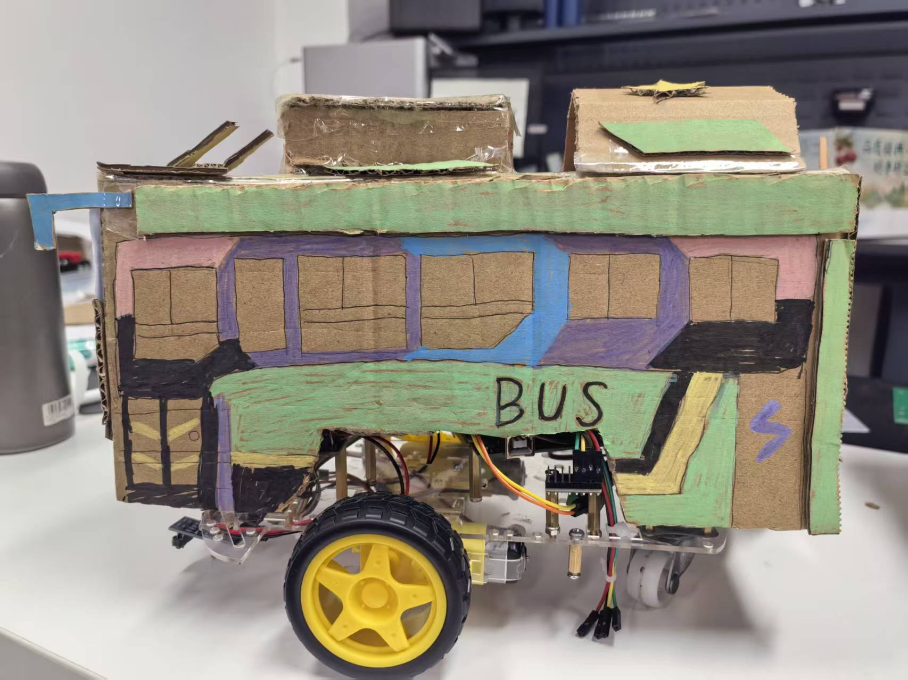
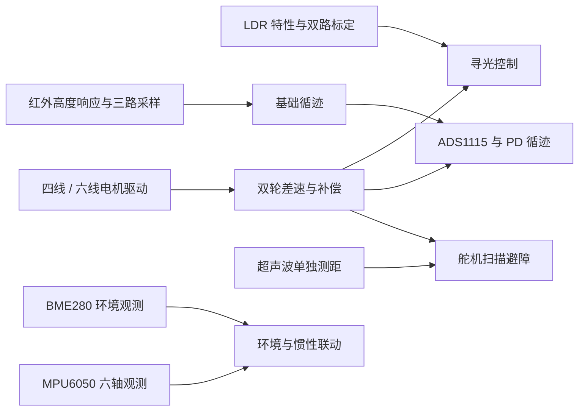

# Arduino 多功能小车

基于 Arduino UNO 的 Bus 造型双轮差速小车，记录从传感器采样、电机测试到寻光、循迹、避障和环境观测的课程设计过程。

**Yuanxi HAN** · Arduino UNO R3 · L298N · LDR / TCRT5000 / HC-SR04 / MPU6050 / BME280



## 按功能浏览

| 分类 | 实现 | 文档 | 程序 |
| --- | --- | --- | --- |
| 光照感知与运动 | 双 LDR 寻光、偏差补偿、暗光停车 | [寻光小车](docs/light-seeking.md) | [light_seeking](firmware/light_seeking/light_seeking.ino) |
| 红外循迹 | 三路 TCRT5000、ADS1115、PD 差速与丢线恢复 | [循迹控制](docs/line-following.md) | [line_following_pd](firmware/line_following_pd/line_following_pd.ino) |
| 超声波避障 | HC-SR04 测距、SG90 扫描、退让与转向状态机 | [超声波避障](docs/obstacle-avoidance.md) | [obstacle_avoidance](firmware/obstacle_avoidance/obstacle_avoidance.ino) |
| 环境观测 | BME280 温度、相对湿度与气压，CSV 串口输出 | [温湿度气压观察仪](docs/environment-monitoring.md) | [bme280_monitor](firmware/environment/bme280_monitor/bme280_monitor.ino) |
| 惯性观测 | MPU6050 三轴加速度、三轴角速度与加速度模长 | [陀螺仪与加速度观测](docs/inertial-monitoring.md) | [mpu6050_monitor](firmware/inertial/mpu6050_monitor/mpu6050_monitor.ino) |
| 环境与运动联动 | 课程 Z 轴阈值启停逻辑，结合 BME280 数据 | [环境与惯性联动](docs/environment-imu.md) | [environment_imu](firmware/environment_imu/environment_imu.ino) |

每个草图单独编译、单独烧录。两个独立观察仪从报告的组合程序拆出，可单独采样而不驱动电机。整车程序沿用各自引脚，切换功能前按[接线总表](docs/hardware-and-build.md)核对，当前没有同时运行全部功能的统一固件。

## 演示

| 内容 | 报告提供的视频 |
| --- | --- |
| 寻光 | [Bilibili 演示](https://www.bilibili.com/video/BV1PkKU6hEKu/) |
| 黑线循迹 | [Bilibili 演示](https://www.bilibili.com/video/BV1pkKU68E97/) |
| 超声波避障 | [Bilibili 演示](https://www.bilibili.com/video/BV1jdKU6DEbN/) |
| 传感器与运动状态测试 | [Bilibili 演示](https://www.bilibili.com/video/BV1pCKU6fEtG/) |

视频对应课程阶段的实测版本。整理时的代码恢复、故障处理与独立拆分见[来源与修改记录](docs/module-source-notes.md)，这些改动尚未进行实车复测。

## 从基础实验到整车功能



[基础实验目录](experiments/README.md)保留电机测速、LDR 采样、红外采样、基础循迹、超声波测距和 I2C 诊断，共七个独立草图。[数据目录](data/README.md)收录可追溯的 LDR 原始读数、红外高度测试与电机计时数据。

## 仓库结构

```text
arduino-car/
├── firmware/              # 六个独立应用草图
│   ├── light_seeking/
│   ├── line_following_pd/
│   ├── obstacle_avoidance/
│   ├── environment/bme280_monitor/
│   ├── inertial/mpu6050_monitor/
│   └── environment_imu/
├── experiments/           # 七个基础实验与诊断草图
├── docs/                  # 原理、接线、标定、来源与验证
├── media/                 # 按功能分类的报告原图
├── data/                  # 原始实验读数与计时数据
├── tools/                 # 批量编译与完整性检查
└── tests/                 # 主机侧控制回归测试
```
