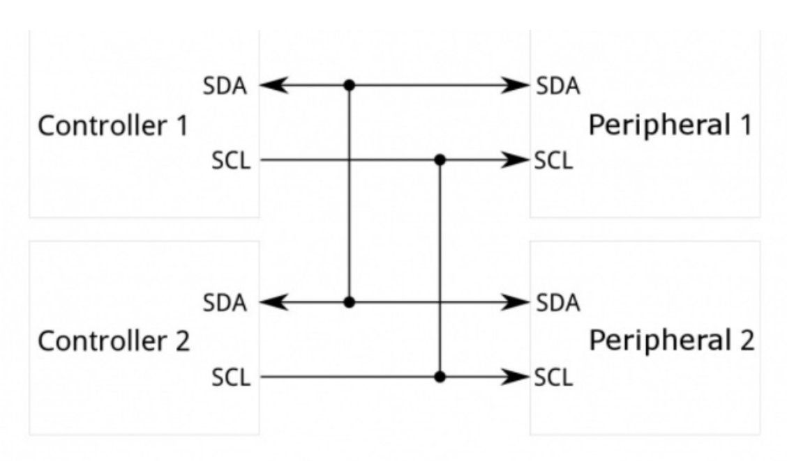

# 环境采集与惯性阈值电机联动

保留期末报告 3.4 的组合实验：BME280 采集温湿度与气压，MPU6050 读取六轴数据，原始 Z 轴加速度触发电机启停。

[完整程序](../firmware/environment_imu/environment_imu.ino) · [独立环境观察仪](environment-monitoring.md) · [独立六轴观察仪](inertial-monitoring.md)

| 原始 Z 轴加速度 | 电机状态 |
| --- | --- |
| `zRaw > -8.0 m/s²` | 运行，两轮 PWM 255 |
| `zRaw < -15.0 m/s²` | 停止，两轮 PWM 0 |
| 两个阈值之间，含端点 | 保留上次状态；上电默认停止 |

两个阈值之间是状态保持区间，未实现 250 ms 时间消抖，也不使用模长进行控制。打印的 `Z=zRaw+1.6` 只用于显示。阈值依赖安装方向与运动过程，不能当作通用离地检测；应先用独立六轴草图实测标定。

## 接线与运行

BME280 地址 `0x76`、MPU6050 地址 `0x68`，共用 UNO A4/SDA、A5/SCL；供电、电平和上拉按模块要求。电机 ENA/ENB 为 D9/D10，IN1-4 为 D6/D7/D4/D5。

原图包含多个控制器，本程序只有一个 UNO 和两个外设。该图不能替代实际供电、电平转换与上拉接线。

串口为 9600 baud，每 1200 ms 输出环境与惯性数据；电机状态每次主循环按 Z 轴更新。先悬空确认启停和方向，再进行整车测试。

整理时增加初始化失败、惯性读取失败或 Z 轴非有限值时停车；移除了未用于采样的 ADS1115；补充输出字段与单位。电机 PWM、量程、阈值和状态保持区间沿用附录。没有添加正文提及但附录缺失的 LCD、模长启停或时间消抖。

[返回项目首页](../README.md)
