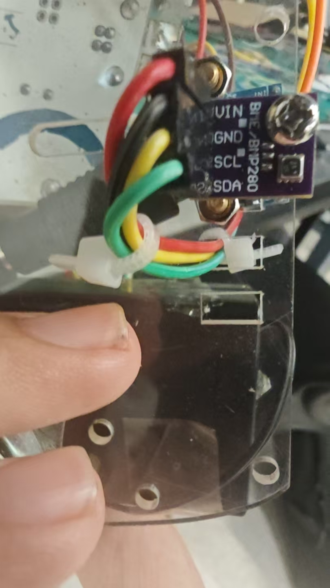

# BME280 温湿度与气压观察仪

从期末报告 3.4 拆出的独立程序，采集温度、相对湿度与气压，输出带表头的 CSV；只需 UNO 与 BME280，不控制电机，不依赖 MPU6050。

[完整程序](../firmware/environment/bme280_monitor/bme280_monitor.ino) · [课程传感器演示](https://www.bilibili.com/video/BV1pCKU6fEtG/)



照片标有 BME/BMP280，不能只凭外观确认湿度功能。程序检查 BME280 初始化；BMP280 不应被当作支持湿度的 BME280。

| 字段 | 单位 | 采集 |
| --- | --- | --- |
| `time_ms` | 上电后毫秒 | `millis()` |
| `temperature_C` | °C | `readTemperature()` |
| `humidity_pct` | %RH | `readHumidity()` |
| `pressure_hPa` | hPa | `readPressure() / 100.0` |

库返回的压力为 Pa，除以 100 后为 hPa。湿度是空气相对湿度，不是土壤含水率。程序沿用报告的 1200 ms 输出间隔，增加单位与非有限读数检查；错误消息行不属于 CSV 数据。

```text
time_ms,temperature_C,humidity_pct,pressure_hPa
```

## 接线与运行

UNO A4/SDA、A5/SCL，共地，按模块额定电压与电平要求供电，确认是否具备适合 UNO 的电平转换。报告地址为 `0x76`；如果实际扫描到 `0x77`，修改 `sensorAddress`。

安装 Adafruit BME280 Library 及依赖，上传并使用 115200 baud 串口。先静置观察，再改变环境检查响应，传感器应避开电机与驱动器的发热影响。初始化失败时可先用 [I2C 扫描](../experiments/i2c/i2c_scan/i2c_scan.ino)核对地址。

独立版本保留报告 API、地址、气压换算和 1.2 s 周期，移除电机与其他传感器依赖，新增 CSV 表头和读数检查。正文提及 LCD，但附录没有 LCD 代码，因此本版本显示入口是串口。

参考：[Adafruit BME280 官方示例](https://github.com/adafruit/Adafruit_BME280_Library/blob/master/examples/bme280test/bme280test.ino)。

[返回项目首页](../README.md)
