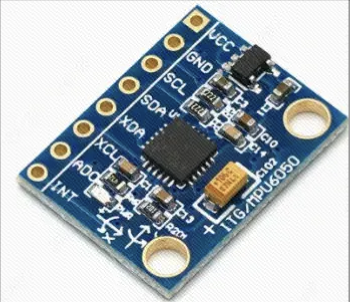
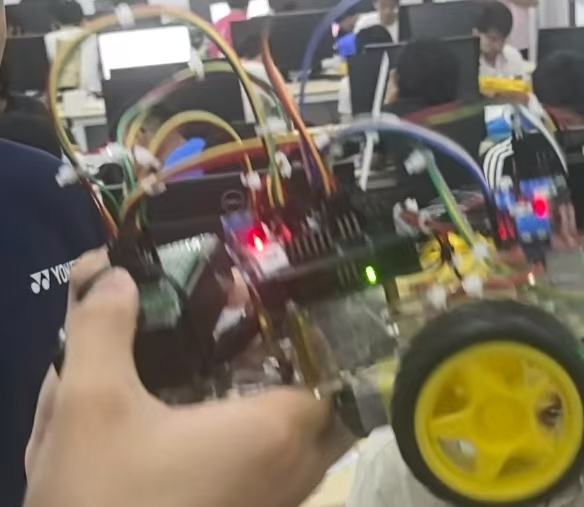
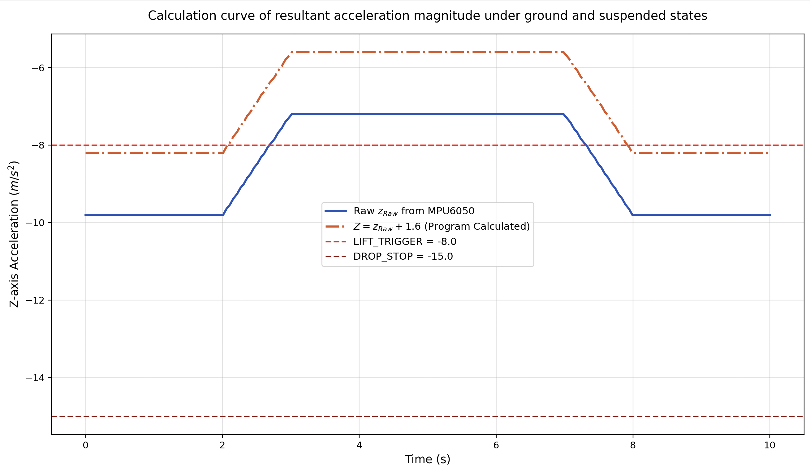

# MPU6050 陀螺仪与加速度观测

从报告 3.4 拆出的独立六轴观察仪，输出三轴加速度、三轴角速度，并新增加速度模长用于观测，不控制电机。

[完整程序](../firmware/inertial/mpu6050_monitor/mpu6050_monitor.ino) · [课程传感器演示](https://www.bilibili.com/video/BV1pCKU6fEtG/)



原报告 Figure 11 实际为器件示意图，可识别引脚，不表示实际安装位置。

## 数据与含义

加速度单位为 `m/s²`，角速度为 `rad/s`。`MPU6050_RANGE_250_DEG` 表示 ±250°/s 的量程设置，库读取的角速度仍以 rad/s 返回。

新增模长为 `sqrt(ax*ax + ay*ay + az*az)`，只用于显示，不判定离地。静止拿在手中与静止放在桌面时都可能观测到接近重力的模长，不能把悬空等同于自由落体。

程序没有积分角速度或姿态融合，输出角速度不等于横滚、俯仰或航向角。

```text
time_ms,ax_m_s2,ay_m_s2,az_m_s2,gx_rad_s,gy_rad_s,gz_rad_s,accel_norm_m_s2
```

串口 115200 baud，间隔 100 ms；加速度 ±2 g、陀螺仪 ±250°/s 沿用附录。错误消息行不属于 CSV 数据。

## 运行与标定

UNO A4/SDA、A5/SCL，共地，供电及电平按模块额定要求。默认地址 `0x68`，若 AD0 配置得到 `0x69`，修改 `mpu.begin()` 地址。安装 Adafruit MPU6050 与 Adafruit Unified Sensor 后上传。

先固定模块记录静止读数，再分别绕 X/Y/Z 轴旋转检查角速度符号；改变静止姿态，比较加速度分量和模长。



报告中按原始 Z 轴启停电机的功能保留在[组合草图](environment-imu.md)，与本独立观察仪分开。



原图标题称“合加速度”，实际图例是 `zRaw` 和 `zRaw+1.6`，且存在负值，应理解为 Z 轴示意。曲线未展示低于 -15 的停止触发数据，不能验证完整启停或模长算法。

参考：[Adafruit MPU6050 官方示例](https://github.com/adafruit/Adafruit_MPU6050/blob/master/examples/basic_readings/basic_readings.ino)。

[返回项目首页](../README.md)
