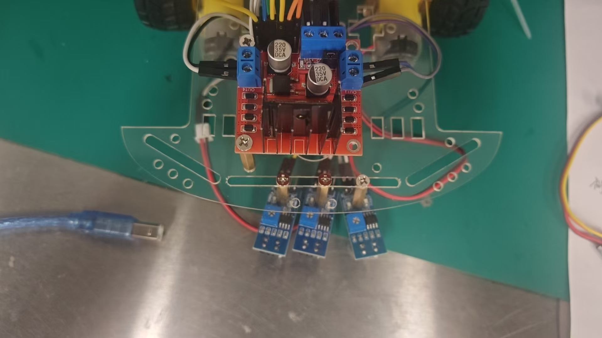
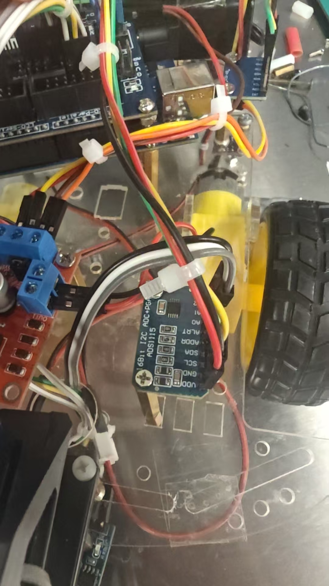
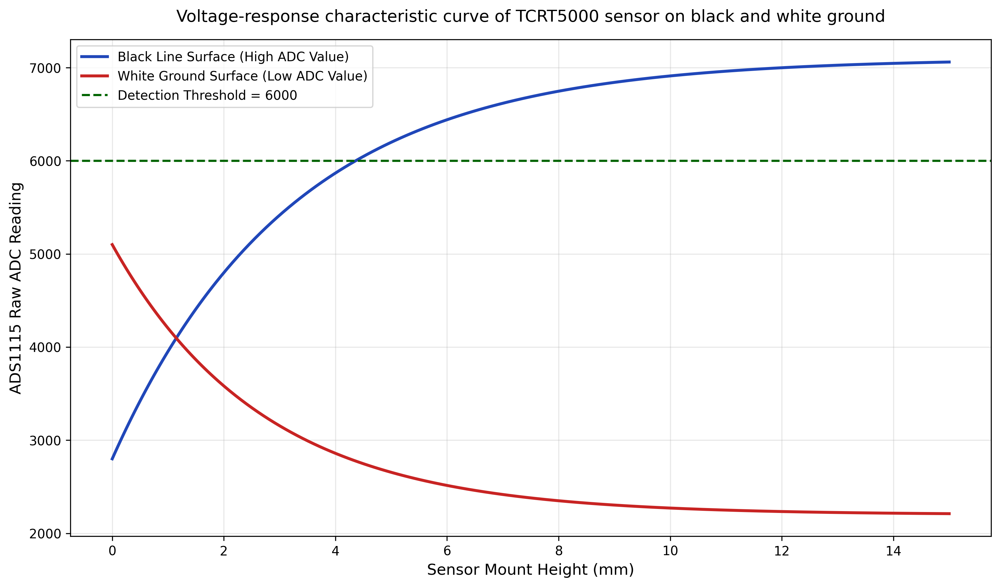
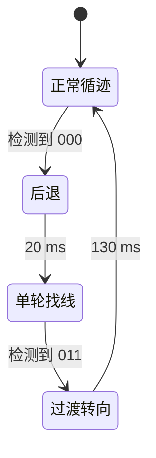

# 三路红外 PD 循迹

三路 TCRT5000 判断黑线相对位置，ADS1115 读取模拟信号，再根据状态映射的偏差调节双电机 PWM。程序来自期末报告 3.2，保留 `Kp=23、Ki=0、Kd=37`，实际为 PD 控制。

[完整程序](../firmware/line_following_pd/line_following_pd.ino) · [循迹视频](https://www.bilibili.com/video/BV1pkKU68E97/) · [基础实验](../experiments/README.md)

## 采样与编码

左、中、右接 ADS1115 的 AIN0、AIN1、AIN2，以 `value >= 6000` 判为黑线，分别写入三位状态的高、中、低位。6000 是 ADS1115 原始读数，不能套用到 UNO 自带的 0-1023 ADC。

| 状态 L/M/R | 原程序偏差 |
| --- | --- |
| `100` / `110` / `010` | +2.5 / +1.2 / 0 |
| `011` / `001` | -1.9 / -2.9 |
| `000` | 依上次偏差取 -2.9 或 +2.0，并进入找线流程 |
| `111` | -2.9，原程序特定路线处理规则 |
| `101` | 保留上次偏差 |

Figure 7 未提供逐点原始数据，这里只用于说明阈值。传感器高度、黑白表面与 ADC 增益需要重新标定。报告部分黑白极性描述与程序相反，本说明按代码编写。

## PD 与丢线恢复

程序计算 `u = 23*error + 37*(error-errorLast)`，随后输出 `left=100+u+5`、`right=100-u`，正常分支限制在 25 到 100。`+5` 是左轮补偿。

误差来自离散状态表，不是左右模拟读数直接相减。微分项未除以采样时间，循环没有固定 10 ms 调度。积分在计算后才限幅，默认 `Ki=0`；以后启用积分项前，需要调整限幅顺序与采样周期。

找线时固定左轮 0、右轮 60，过渡时左轮 60、右轮 30，并未依照历史偏差选择找线方向。若始终无法识别 `011`，原流程没有退出超时，测试时应保持可手动断电。

## 运行

电机 ENA/ENB 使用 D9/D10，IN1-4 使用 D6/D7/D4/D5。ADS1115 默认地址 `0x48`，UNO SDA/SCL 为 A4/A5，详见[接线总表](hardware-and-build.md)。

安装 Adafruit ADS1X15，上传后使用 9600 baud 串口。先确认黑白阈值和通道顺序，再测试居中、左右弯和丢线恢复。整理版本增加 ADC 初始化失败时停车。

报告中的“100% 准确率”和直线／弯道速度缺少统计与测速依据，附录也没有轮速测量，本项目不将其列为已复测指标。库参考：[Adafruit ADS1X15](https://github.com/adafruit/Adafruit_ADS1X15)。

[返回项目首页](../README.md)
