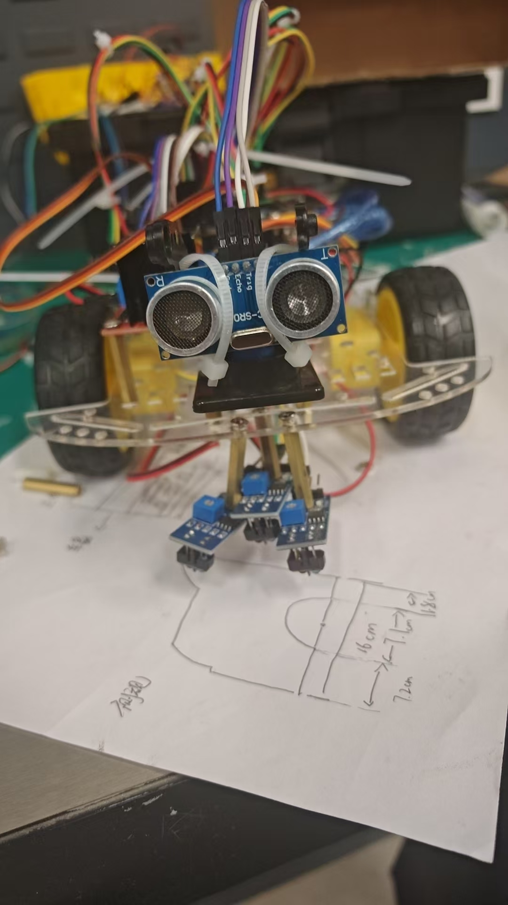
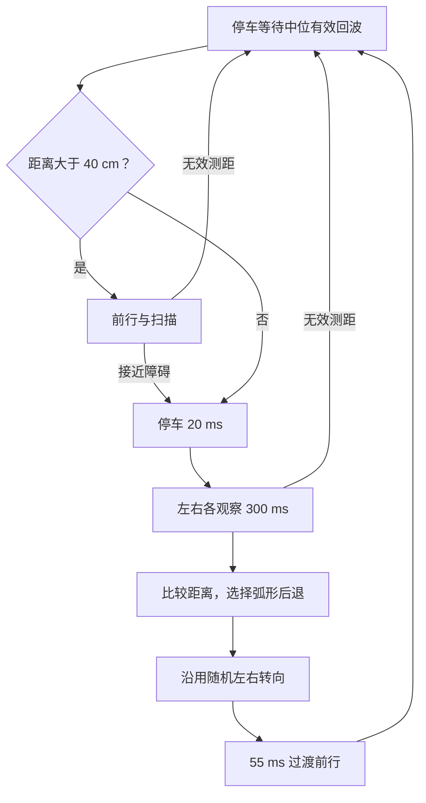
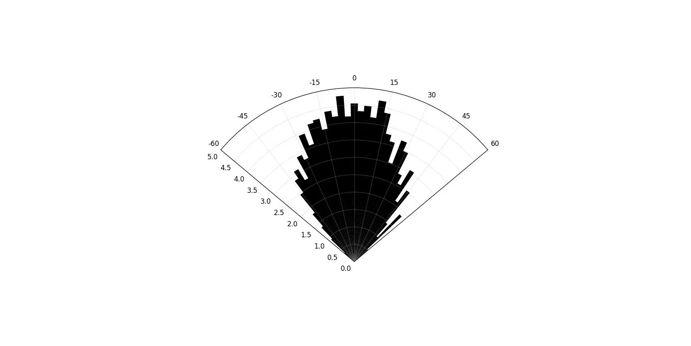

# 舵机扫描超声波避障

HC-SR04 随 SG90 扫描，接近障碍后停车、左右观察、弧形后退，再转向恢复前行。程序以期末报告 3.3 为基础，恢复被裁切的状态入口，并修正明确的控制问题。

[完整程序](../firmware/obstacle_avoidance/obstacle_avoidance.ino) · [独立测距](../experiments/ultrasonic/ultrasonic_distance/ultrasonic_distance.ino) · [避障视频](https://www.bilibili.com/video/BV1jdKU6DEbN/)

## 测距与动作

发出 10 微秒触发脉冲后，用 `pulseIn()` 读取回波高电平时长，距离近似为 `distance_cm = duration_us / 58`。附录超时为 `8000 us`，等效回波距离约 138 cm；400 cm 是结果合法性上限，不能据此宣称可测 4 m。

无回波、过短和越界读数记为无效值 0，保持停车并重新测距。无回波也可能是距离过远，因此空旷环境可能停住，这是当前处理的取舍。[Arduino pulseIn 官方参考](https://docs.arduino.cc/language-reference/en/functions/advanced-io/pulseIn/)说明超时可能返回 0。

| 项目 | 附录参数 |
| --- | --- |
| 中位与前行扫描 | 87°；42°-138°，每 7 ms 调整 2° |
| 左右观察 | 15° / 165°，各等待 300 ms |
| 接近 / 极近阈值 | 40 / 12 cm |
| 普通 / 极近后退时间 | 720 / 850 ms |
| 原地转向 / 过渡前行 | 175 / 55 ms |

舵机左右取决于安装方向，175 ms 不是已测得的固定转角。

扫描时 `Fdist` 是当前扫描方向的距离，不总是正前方距离。附录没有实现正文中的侧向几何投影公式，也不是固定右转 90°。

## 接线与使用

| UNO | 模块 |
| --- | --- |
| D12 / D13 | HC-SR04 Trig / Echo |
| D3 | SG90 信号 |
| D5 / D6 | L298N ENA / ENB |
| D11 / D10 / D8 / D9 | L298N IN1 / IN2 / IN3 / IN4 |

原函数通道 1 输出右轮、通道 2 输出左轮，方向电平也与寻光不同。使用匹配电源并共地，先悬空确认各动作。UNO 上 Servo 库影响 D9/D10 的 PWM，因此按附录使用 D5/D6 控速，参见 [Servo 官方说明](https://github.com/arduino-libraries/Servo/blob/master/docs/readme.md)。

安装 Servo，串口设为 115200 baud。先运行独立测距检查回波，再检查舵机中位、左右方向和电机动作，最后低速地面测试。

Figure 9 缺少可核对的径向单位与原始数据，仅展示资料，不据此给出误差精度。

## 整理修正

- `sweepDir` 从无符号 `byte` 改为 `int8_t`，让 -1 正确表示反向。
- 检出障碍后立即离开前行分支，防止停车后同轮再次调用 `advance()`。
- 根据状态名称与动作函数补全裁切的 `enterState()`，使用枚举命名。
- 启动、恢复或无效回波时停车，等待中位稳定与有效距离。

这些修改通过主机控制测试，实际声学表现、转向与倒车距离仍需复测。

[返回项目首页](../README.md)
